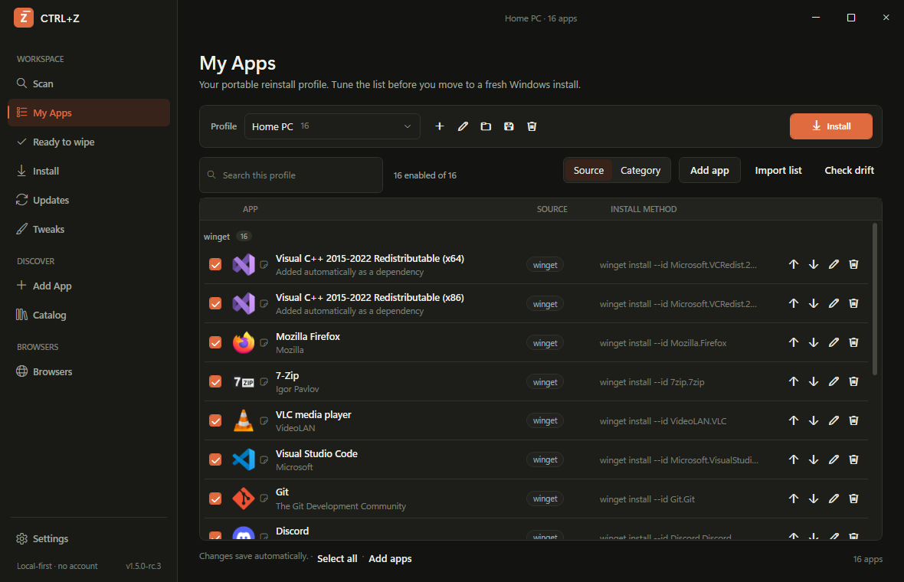
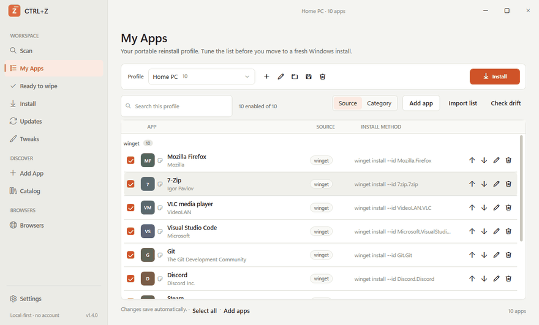

# CTRL+Z

**Undo a clean Windows install.**

[github.com/IAM-GROOT1/ctrlz](https://github.com/IAM-GROOT1/ctrlz)

CTRL+Z is a local-first Windows desktop app that rebuilds your app list and restores your
Chromium and Firefox browser profiles after a fresh install. It scans what is installed now,
saves a portable JSON profile, and reinstalls it silently later — including apps winget does
not carry. It also makes full browser-profile backups for browsers without sync, with a
focus on Helium, Zen, and multiple profiles.



| Scan | Add an app | Catalog |
| --- | --- | --- |
|  |  |  |

A 25-second tour: a saved profile, the install preview, the pre-wipe check and a reversible tweak.



## Why this stack

I chose **.NET 8 + WPF** with a custom Fluent-inspired theme rather than Tauri/Electron:

- **No WebView2, Node, Rust, or JS runtime requirement.** A self-contained single-file
  `.exe` runs on a clean Windows 10/11 install.
- **Native Windows integration** for UAC relaunch, registry, shell icons, App Installer,
  process control, and Volume Shadow Copy.
- **A real GUI** that can be a proper Windows citizen — custom chrome, rounded
  corners, system light/dark themes, keyboard navigation, and native file dialogs.
- **Testable core.** `CtrlZ.Core` is a plain .NET class library; the installer, scan,
  winget matching, profile, and browser archive logic have no WPF dependency.

The UI deliberately uses a restrained ember accent, a small type scale, 8px surfaces, and
Segoe Fluent Icons — not a dashboard template. There are no gradients, glass panels, or
emoji icons.

## Features

### Rebuild apps

- Scan three sources: **winget**, **Windows registry Uninstall keys**, and **Microsoft Store
  (Appx)** apps.
- Match installed names to winget package ids with a conservative, tested matcher.
  Unmatched entries are grouped for manual fixing with a winget search dialog.
- Searchable, filterable lists; filter by **All apps / Matched / Unmatched**, filter by category,
  group by category or source, and multi-select. **Select all** selects every app visible under the
  active filter; **Select matched** is the matched-only shortcut.
- Save **multiple portable profiles** (`Work PC`, `Gaming PC`, …) as human-readable JSON;
  import/export them anywhere. **Export** says what needs attention on the other PC (local
  installers to copy along, post-install commands that stay blocked until reviewed there) and
  leaves app notes out of the file unless you tick *Include my notes*.
- **Import an app list** from another package manager: **My Apps → Import list** reads the file
  from `winget export -o apps.json`, `scoop export > apps.json` (or its older text output) or
  `choco export` (`packages.config`). winget and Store ids are added as they are. Scoop and
  Chocolatey names are matched to winget through the catalog already on this PC, with no network
  lookup, and anything that could not be matched is listed for you to add by hand. You see the
  list before anything is added. Imported apps carry only a package id and a name.
- Add apps winget does not carry:
  - **Direct download URL** with silent switches and optional SHA-256.
  - **GitHub release** with latest-release asset selection (`.exe`, `.msi`, `.zip`,
    portable). The latest release is resolved again at install time.
  - **Local installer** on a folder or USB drive, with silent switches.
- Built-in installer detection for **Inno Setup, NSIS, MSI, InstallShield, Squirrel, WiX
  Burn, MSIX**, plus a detected-type / command-preview inspector and a real test-install
  action for switches.
- A browsable **Chris Titus Tech WinUtil catalog** refreshed from the public repo, with an
  embedded snapshot + cached fallback for offline use.
- Silent, ordered installation with **per-app status, progress, live logs, retry, pause,
  resume after reboot, failed-app isolation, and UAC relaunch**.
- winget bootstrap: if winget is missing, CTRL+Z downloads Microsoft App Installer; if it
  is old, it attempts an App Installer upgrade. If Microsoft's short link fails, the same bundle
  is fetched from Microsoft's own winget-cli releases.
- Resilient downloads: a dropped connection continues where it stopped instead of starting over.
  This uses a range request that only succeeds while the server still has the same file (same
  ETag or Last-Modified), so a file that changed is downloaded fresh, never stitched together.
  Server errors and transfers that stall for a minute are retried up to 3 times, and the SHA-256,
  when known, is always checked over the whole file. A partial download that cannot be resumed
  safely is restarted.
- Download verification: winget verifies its own manifests; direct/GitHub/local downloads
  verify a supplied SHA-256, and GitHub release asset digests are used automatically when
  present. When GitHub has no digest for an asset, a checksum file published in the same release
  (`setup.exe.sha256`, `SHA256SUMS`, `checksums.txt`, …) is used instead; only SHA-256 entries
  count, and a file that lists the asset twice with different hashes stops the install.
- Signature check: before CTRL+Z runs an `.exe` or `.msi`, or copies a portable `.exe`, Windows
  checks its Authenticode signature, and the result and signer appear in the install log. A
  **broken** signature (the file was changed after signing, or the certificate was revoked or is
  distrusted) stops the install. Unsigned installers still run, and the log says so. The check
  works offline and adds no network request, so revocation is not looked up: a revoked certificate
  is caught only if Windows already distrusts it. The signature catches a signed file that was
  altered, not a file replaced by an unsigned or differently signed one. For that, a published or
  saved SHA-256 is the check.

### Chromium and Firefox browser backup

- Auto-detects **Chromium** browsers: Chrome, Edge, Brave, Vivaldi, Opera/Opera GX, **Helium**,
  Chromium, Thorium, Yandex, Comet, Arc, and Whale.
- Auto-detects **Firefox-family** browsers: Firefox/ESR, **Zen**, LibreWolf, Waterfox, Floorp,
  **Mullvad Browser**, and **Tor Browser**. Custom profile roots are supported for any fork.
- Reads real profile display names: Chromium from `Local State`, Firefox from `profiles.ini`
  (with a folder-name fallback for single-profile bundles).
- Select browsers and individual profiles.
- **Chromium backups include:** open tabs and sessions, history, bookmarks, extensions and
  extension data, preferences/flags (`Local State` + `Preferences`), search engines (sanitized
  `Web Data`), and site permissions.
- **Firefox backups include:** `prefs.js`/`user.js`, `places.sqlite` (bookmarks and history),
  `sessionstore.jsonlz4` and session backups, `extensions/` + extension metadata and storage,
  search engines (`search.json.mozlz4`), `permissions.sqlite`, bookmark backups, and `chrome/`
  customizations.
- **Never backs up saved passwords or cookies.** Chromium `Login Data`, `Cookies`, `Network`
  cookie stores, and related files are excluded; Firefox `logins.json`, `key4.db`, `cookies.sqlite`,
  `formhistory.sqlite`, and related credential stores are excluded.
- Excludes caches, shader caches, crash dumps, service-worker caches, thumbnails, and temp files.
- Shows the estimated size before starting.
- Detects a running browser (Chromium or Firefox process) and offers to close it gracefully or
  force-close it. Locked files fall back to **Volume Shadow Copy** when the app is elevated and
  VSS is available.
- One compressed ZIP per browser with a manifest (engine/family, browser, version, profiles,
  date, file list, contents, exclusions). Optional **AES-256 password encryption**.
- **Verify** a backup before you wipe: it reads every file in the archive with its password,
  checks each one (checksum or AES authentication), confirms every listed profile is present and
  that no passwords or cookies were added, and reports whether it can be restored. Nothing is
  written.
- **Restoring on a PC that never had the browser:** if the backup's browser isn't installed,
  the restore panel offers to install it with winget (Chrome, Edge, Brave, Vivaldi, Firefox,
  LibreWolf, Waterfox, Zen). Open it once so it creates its own data folder, close it, press
  **Refresh**, and restore.
- Restore flow: inspect archive → choose profiles → choose a target browser of the **same engine**
  → **restore as new profiles (recommended)** or merge into existing profiles after a warning.
  New Firefox profiles are registered in `profiles.ini`; new Chromium profiles in `Local State`.
  Existing cookies/passwords are left untouched; a small safety copy of key current files is made
  before writing.
- Per-browser configuration lives in
  [`ChromiumBrowserCatalog`](src/CtrlZ.Core/Services/ChromiumBrowserCatalog.cs) and
  [`FirefoxBrowserCatalog`](src/CtrlZ.Core/Services/FirefoxBrowserCatalog.cs).


### App updates

The **Updates** page asks winget which installed apps have a newer version and lists them with the
installed and available versions. Update the ones you tick, or all of them, one after another.
Apps winget marks as pinned are only updated when you pick them, never by **Update all**, and
**Ignore this version** hides one version of one app until a newer one appears. Updates share the
install lock, so they never run while an install queue or the command line is installing.

Apps CTRL+Z installs from a GitHub release are remembered with their release, and the same page
offers a newer release when the repository publishes one. Portable apps (a single exe or a ZIP)
get a Start menu shortcut under **CTRL+Z apps**; turn this off in **Settings → Installing**.

### Everything else

- Clean empty states, inline errors, graceful per-item failure handling.
- All logs written to `%LOCALAPPDATA%\CTRL+Z\logs` and openable from Settings.
- Light/dark theme follows Windows by default.
- No account, telemetry, or cloud service.
- **Tweaks** (Ctrl+9): eight small Windows settings to set again after a reinstall, such as
  showing file extensions, dark mode or the classic right-click menu.
  - Each changes only a few per-user registry values, needs no admin rights and runs no command.
  - CTRL+Z saves what was there first, so **Undo** puts it back exactly.
  - Applied tweaks are listed in your profile, so on the new PC the page offers to apply them
    again. Nothing is applied until you press the button.
- **Keyboard and screen readers:**
  - **Ctrl+1 to Ctrl+9** open Scan, My Apps, Install, Add App, Catalog, Browsers, Ready to wipe,
    Updates and Tweaks, and **Ctrl+,** opens Settings.
  - In every window, Enter accepts and Esc closes, and dialogs start with focus in their first
    field.
  - Every control has a name a screen reader can read.
  - With Windows' *Animation effects* turned off, pages switch without a fade.

## Install from the built artifacts

Download the latest build from [Releases](https://github.com/IAM-GROOT1/ctrlz/releases/latest). The release artifacts are (also copied to `dist/`):

- `CTRL+Z-Portable-1.1.3.exe` — a single self-contained executable. Put it anywhere and
  run it. No .NET install required.
- `CTRL+Z-Setup-1.1.3.exe` — per-user Inno Setup installer (Start Menu shortcut, optional
  desktop shortcut, uninstaller). It does not require admin to install.

The binaries are **not code-signed**, so SmartScreen may show an unknown-publisher prompt.
Build from source or sign the executable if you distribute it broadly.

### Removing CTRL+Z

- **Installed copy:** uninstall from *Settings → Apps*. The uninstaller asks whether to also
  delete your CTRL+Z data in `%LOCALAPPDATA%\CTRL+Z`: profiles, settings, logs, install state
  and any portable apps CTRL+Z installed, along with their *CTRL+Z apps* Start menu shortcuts.
  The default is **No**, so reinstalling picks up where you left off. A silent uninstall always
  keeps the data. Browser backups and exported profiles you saved elsewhere are never touched.
- **Portable copy:** delete the exe (and `ctrlz.exe` beside it). To remove its data too, delete
  `%LOCALAPPDATA%\CTRL+Z`, or the `Data` folder beside the exe if you used `portable.flag`.

### Portable data

By default the portable exe still keeps profiles, logs, and settings under
`%LOCALAPPDATA%\CTRL+Z`. For a fully portable data folder next to the exe, create an empty
file named `portable.flag` beside `CTRL+Z.exe` before launching. Data then lives in
`.\Data\`. You can also set `CTRLZ_DATA_DIR` to an explicit folder.

Profiles are portable regardless: export them from **My Apps → Export** and keep the JSON
with the installer or on a USB drive.

## Updates

CTRL+Z can check GitHub for a newer release and update itself.

- **Where the version comes from.** The build stamps the version from the git tag into the
  assemblies, the installer and the asset names, so the app, the release and the files always
  agree. The tag is the single source of truth; nothing is hard-coded.
- **What is checked.** CTRL+Z asks GitHub's public API for the releases of `IAM-GROOT1/ctrlz`,
  picks the newest one for your channel (**Stable** ignores pre-releases, **Pre-release**
  includes them) and compares it with the running version. Drafts are ignored, and an older
  release is never offered as an update.
- **What is downloaded.** An installed copy downloads `CTRL+Z-Setup-<version>.exe`; a portable
  copy downloads `CTRL+Z-Portable-<version>.exe`. Only HTTPS assets from this repository's own
  releases are accepted. Every download is checked against the release's `SHA256SUMS.txt` (or
  the API digest); a file that does not match is deleted and never applied.
- **Turning it off.** **Settings → Updates** has a *Check for updates automatically* toggle, a
  channel switch and a manual **Check for updates** button. *Skip this version* keeps that
  version quiet until a newer one ships.
- **If a new version fails to start.** The updater keeps the previous version beside the app
  until the new one has shown its window twice. If it closes before its window appears, or a
  later start never shows it, the previous version is put back and you are told why. This covers
  updates made from 1.4 onward for portable copies, and from the release after 1.4 for installed
  copies (the update is run by the version being replaced). From the release after 1.4, the
  version that failed is also skipped until a newer release appears.
- **Interruptions.** CTRL+Z never prompts or applies an update while an install queue, browser
  backup or restore is running; the prompt waits for the operation to finish.
- **Privacy.** The release check and an update download are the only network requests this
  feature makes. They send no token and no identifiers, and CTRL+Z has no telemetry.
- **Testing a fork (debug builds only).** A `DEBUG` build accepts the environment variable
  `CTRLZ_UPDATE_REPO=owner/name` to point the release check at a fork. It can change *only* the
  repository owner and name: the API host, the URL shape and the GitHub-only list of allowed
  asset hosts stay fixed, and the value is rejected unless it is exactly `owner/name`. Release
  builds ignore the variable entirely and always use `IAM-GROOT1/ctrlz`.

## Before you wipe

Three checks help make sure a clean install does not lose anything.

**Ready to wipe?** (Workspace → Ready to wipe) is a read-only report with a pass / warning / fail
verdict. It sizes Desktop, Documents, Downloads, Pictures, Videos and Music (plus any other fixed
drive), finds game launchers and the folders saves usually live in, notes developer material such
as `~/.ssh`, `.gitconfig`, `.env` files and WSL distributions, checks how old each browser backup
is, and lists the reminders only you can tick off — password-manager export, licence keys,
deactivating software, saving Wi-Fi passwords and recovery keys. Items you mark **handled** or
**ignore** are remembered on this PC.

It never modifies, moves or deletes a file, makes **no network requests**, and writes only counts
and sizes to the log — never the names of files in your personal folders. Large folders are walked
with depth, file-count and time limits, junctions are skipped so a loop cannot hang the scan, and
the check runs in the background with progress and a Cancel button.

**Profile drift** (My Apps → Check drift) compares the saved profile with what is actually
installed and groups the difference into Missing, Extra and Outdated. Apps are matched by winget
package id first, then by name and publisher, and the confidence is shown per row; genuinely
ambiguous matches are left as "uncertain" instead of guessed. Each row can add the app to your
profile, remove it, install a missing app, or ignore it permanently.

**Install preview** (on by default; Settings → Installing) shows what an install run will do —
order, source, silent switches, whether admin is likely, and any warnings — and offers a **Dry
run** that verifies every winget id, GitHub asset, download link and local installer without
installing anything. The result can be exported as text. Only the dry run touches the network,
and only to look things up.

What these checks do **not** cover: files inside password-protected backup apps, cloud-only files
that are not downloaded, and data that lives only in an online account.

## Post-install commands

An app can carry one optional command that runs after it installs, for example importing a
settings file. Commands are built to be safe to share profiles with:

- **No shell.** The program and each argument are passed separately; nothing is concatenated into
  a command line. A command that runs too long is stopped together with everything it started.
- **Shown in full.** The install preview and the dry-run report list every command with its state:
  *Runs after install*, *Approved - runs after install*, *Edited since approval - needs review*,
  *Blocked - imported profile, review required*, or *Off in profile - will not run*. Commands
  matching a risky pattern (for example downloading and executing a script) are flagged.
- **Imported profiles are blocked.** A profile that did not originate on this PC (opened from a
  file, imported, or with no local record) never runs a command until you approve that exact
  command in **Review commands** in the install preview. The preview is on by default; with it
  turned off in Settings there is no review, so imported commands simply stay blocked. Approvals
  are stored on this PC only, never in the profile file, and each one belongs to one command of one
  app. Editing a command changes it, so it needs review again before it can run.
- **Only your own profiles can edit commands.** The app editor shows the command fields only for a
  profile created on this PC. *This profile is mine* in the review screen marks an imported profile
  as yours, after an explicit confirmation.
- **You confirm before anything runs.** Before a command first runs on this PC, CTRL+Z lists every
  command the profile will run and asks; it asks again whenever a command's text is new or changed.
  A risky command asks again on every run, and needs a second confirmation when you save it.
  Declining starts nothing and records nothing.
- The dry run never runs a command.

## Privacy

CTRL+Z is local-first: no account, no telemetry, no analytics.

- **The ready-to-wipe checklist and profile drift make no network requests at all.** They read
  local state only — directory listings, registry keys, file timestamps and the app list.
- **The install dry run is the only safety check that touches the network, and only when you
  press Dry run.** It performs read-only lookups (a winget search, the GitHub release API, and a
  HEAD request for direct links) to confirm each source exists. Opening the preview, or viewing
  the checklist, never triggers a request.
- **Logs contain counts and sizes only.** No file or folder name from your personal folders is
  written to the application log or to the diagnostics copy. Every log line, including install
  logs, writes your personal folders as `%USERPROFILE%`, `%LOCALAPPDATA%`, `%APPDATA%` or `%TEMP%`
  and replaces your Windows account and PC names, and `state/install-state.json` stores the same
  tokens.
- **Checklist state contains no paths.** `state/safety-state.json` holds only checklist item ids,
  handled/ignored flags and ignored drift keys.
- **Private material is never read.** The developer check counts `.env` files and `~/.ssh`
  entries by listing directories; it never opens them. A test holds those files open
  exclusively and still expects the scan to succeed, which proves no read is attempted.
- **App notes stay on this PC unless you opt in.** Notes are stored as plain text in the profile
  file, so never put passwords in them. They are never written to the log. Exports (such as the
  dry-run report) show *(note hidden)* unless **Include notes in exports** is turned on in
  Settings. The diagnostics copy holds no profile data at all. On the install screen, an app's note
  is shown when that app failed or needs manual action.
- **Diagnostics are made only when you ask, and never sent.** **Copy diagnostics** in Settings
  copies a summary of versions, settings switches and counts. **Save diagnostics** writes that
  summary and your last 7 CTRL+Z logs to a ZIP you choose. In the logs, file paths become
  `<path>`, personal folders keep only their token, and the account and PC names are hidden. No
  profile, app list, note, post-install command or browser data goes in. App names can appear in
  log lines, so open the ZIP before you share it.
- The updater is separate: see [Updates](#updates) for the single check it makes.

## Build and run

### Requirements

- Windows 10 1809+ or Windows 11, x64.
- [.NET 8 SDK](https://dotnet.microsoft.com/download/dotnet/8.0).
- Optional, only for the installer: [Inno Setup 6.3+](https://jrsoftware.org/isdl.php)
  (`ISCC.exe` on `PATH`, or under `.tools/InnoSetup6/ISCC.exe`).

The app itself runs on a clean Windows install with no prerequisites thanks to the
self-contained publish.

### Run from source

```powershell
git clone https://github.com/IAM-GROOT1/ctrlz.git
cd ctrlz
dotnet restore
dotnet run --project src/CtrlZ.App
```

### Tests

```powershell
dotnet test
```

The test suite covers: profile JSON round-tripping/import, winget name matching and table
parsing, silent-switch detection, Chromium and Firefox profile parsing, browser data exclusion
planning, Local State/Web Data sanitization, Firefox credentials exclusions, archive
creation/encryption, Firefox and Chromium restore into new profiles, install-state
resume/retry, and file/portable installer execution.

### Build the portable single exe

```powershell
.\build\publish.ps1
```

The version is derived from the newest git tag; pass `-Version 1.2.0` to override it.

Outputs:

- `artifacts/publish/portable/CTRL+Z.exe`
- `artifacts/CTRL+Z-Portable-<version>.exe`
- README + LICENSE next to the portable build

The script uses `dotnet` from `PATH`, or a local `.tools/dotnet/dotnet.exe` if present.

### Build the installer

```powershell
.\build\build-installer.ps1
```

Output: `artifacts/installer/CTRL+Z-Setup-<version>.exe`.

If you use Winget, verify that it installs Inno Setup 6.3+ (the 6.x line is free for commercial use). The vendor still publishes 6.7.4 alongside newer releases.

## Releasing

Releases are produced by `.github/workflows/release.yml`, which runs only when a version tag is
pushed:

```powershell
git tag v1.2.0
git push origin v1.2.0
```

The workflow restores, builds in Release, runs the tests, stamps the version from the tag into the
assemblies and the installer, builds the installer and the portable exe, writes `SHA256SUMS.txt`,
and publishes a GitHub release with those assets attached. It needs no release secrets: it uses
only the built-in `GITHUB_TOKEN`. Code signing is deliberately not implemented yet; the workflow
marks the place where it will go.

Two details keep releases reproducible: the release workflow builds the whole solution
(`CTRL+Z.sln`, so `CtrlZ.App` is compiled too) before running the tests, and Inno Setup is pinned
to an exact version whose installer SHA-256 is verified before it runs
([`build/install-inno-setup.ps1`](build/install-inno-setup.ps1)). The workflow fails rather than
publish a release without `SHA256SUMS.txt`.

A version containing a hyphen is published as a **pre-release**, which is what the updater's
pre-release channel looks for:

```powershell
git tag v1.3.0-beta.1
git push origin v1.3.0-beta.1
```

### Asset naming

The updater selects assets by exact name, so the naming is part of the contract:

| Asset | Pattern | Used by |
| --- | --- | --- |
| Installer | `CTRL+Z-Setup-<version>.exe` | installed copies |
| Portable | `CTRL+Z-Portable-<version>.exe` | portable copies |
| Checksums | `SHA256SUMS.txt` | verification of both |

`<version>` is the tag without its leading `v`, for example `1.2.0` or `1.3.0-beta.1`. Renaming an
asset breaks automatic updates for that release: the updater will refuse to guess.

### Website rebuild hook

The site in the separate website repository shows the latest release, the changelog and this
roadmap, so it has to rebuild when this repository changes. Two places ask Cloudflare Pages to
rebuild through a deploy hook:

- the final step of `release.yml`, after the release is published and its assets verified; and
- `rebuild-site.yml`, on a push to `main` that touches `README.md`, `ROADMAP.md`, `CHANGELOG*` or
  `docs/**`.

Both read the URL from the `CLOUDFLARE_PAGES_DEPLOY_HOOK` repository secret. Without the secret they
print a notice and skip, and a failed call only produces a warning: a website rebuild never fails a
release. Call the hook from inside the release workflow rather than from a `release` event, because
releases created with the built-in `GITHUB_TOKEN` do not trigger other workflows.

To set it up, create a deploy hook named `app-repo-release` for the production branch under
**Workers & Pages** > project > **Settings** > **Builds** > **Deploy hooks**, then store the URL:

```powershell
gh secret set CLOUDFLARE_PAGES_DEPLOY_HOOK --repo IAM-GROOT1/ctrlz
```

See [`docs/website-hook.md`](docs/website-hook.md) for the details and failure behaviour.

## Using CTRL+Z on a fresh Windows install

On first launch, a short welcome guide walks through both halves (before you reinstall, and on
the fresh install) and opens the right page. Open it again with **Settings → Welcome guide**.

1. Copy the portable exe or run the setup **and your exported profile JSON**.
2. Launch CTRL+Z. Open **My Apps → Import** and choose your profile (or use the profile
   already on the machine if you copied the data folder).
3. Review enabled apps and install order. Use **Add App** for custom sources, or **Catalog**
   for recommended apps.
4. Open **Install** and click **Install everything**. Accept the UAC prompt to restart CTRL+Z
   elevated; the app automatically resumes the saved queue after the relaunch.
5. If an installer needs a restart, CTRL+Z records it. Restart Windows and reopen CTRL+Z;
   the install queue resumes at the next unfinished app.
6. Open **Browsers → Restore**, inspect your archive, choose profiles and the target browser,
   and restore as new profiles (recommended) or merge into existing ones.

## Command line

`ctrlz.exe` is installed next to `CTRL+Z.exe` and uses the same data folder (including portable
mode). The portable release ships it as `ctrlz-<version>.exe`: save it as `ctrlz.exe` next to the
portable exe, and the app's updater keeps it current (checked against `SHA256SUMS.txt`, rolled back
together with the app). A ctrlz.exe that is running during the update is replaced too; its
old copy is removed by the next update.

```powershell
# On a fresh Windows install, from a terminal in the folder with your profile and ctrlz.exe:
.\ctrlz.exe dry-run .\my-apps.json            # checks every source, installs nothing
.\ctrlz.exe install .\my-apps.json            # prints the full plan, installs nothing
.\ctrlz.exe install .\my-apps.json --yes      # installs after you read the plan
.\ctrlz.exe list                              # profiles saved in the app
.\ctrlz.exe updates                           # app updates winget can apply, changes nothing
.\ctrlz.exe updates --all --yes               # updates them, except pinned and ignored apps
.\ctrlz.exe updates --id Mozilla.Firefox --yes
.\ctrlz.exe version                           # prints the version, for example "ctrlz 1.4.0"
```

The command line follows the app's safety rules:

- **Nothing installs without `--yes`.** Without it the plan is printed, including every
  post-install command in full, and the exit code is 5.
- **Commands from outside this PC stay blocked.** A profile file is loaded like any import, so its
  post-install commands do not run with `--yes` alone. `--allow-commands --yes` is your explicit
  consent for exactly the commands printed above it: they are approved on this PC, as the review
  screen would. Risky commands additionally need `--allow-risky`, on every run.
- **Admin rights are checked first.** If an app or command likely needs administrator rights and
  the terminal is not elevated, nothing is installed (exit code 6). Run from an elevated terminal,
  or add `--continue-without-admin`.
- **One install at a time.** If the app or another `ctrlz` is installing, the run stops (exit 7).
- `--json <path>` writes a report; app notes appear in it only when **Include notes in exports**
  is on. `--silent` prints the plan and the summary only.

Exit codes: 0 success, 1 usage, 2 some apps failed, 3 invalid profile, 4 a dependency failed, 5 not
confirmed or cancelled, 6 needs administrator rights, 7 another install is running, 8 unexpected
error (details in the log). Checks run in
this order: risky commands, administrator rights, then `--yes`.

## Profile JSON

Profiles are intentionally simple and diffable:

```json
{
  "schemaVersion": 1,
  "id": "…",
  "name": "Work PC",
  "apps": [
    {
      "name": "7-Zip",
      "source": "winget",
      "packageId": "7zip.7zip",
      "category": "utilities",
      "enabled": true
    },
    {
      "name": "Notion",
      "source": "directUrl",
      "downloadUrl": "https://…",
      "silentArgs": "--silent",
      "expectedSha256": "…"
    },
    {
      "name": "Obsidian",
      "source": "github",
      "gitHubRepo": "obsidianmd/obsidian-releases",
      "gitHubAssetExtension": ".exe",
      "gitHubAssetKind": "installer"
    }
  ]
}
```

Paths for local installers are absolute by design; reconnect the same USB drive or edit the
path in **My Apps → Edit**.

## Architecture

```text
src/CtrlZ.Core                 UI-independent logic (net8.0-windows)
  Models/                      Profiles, app entries, install state, browser archives
  Services/                    Scanner, winget CLI/parser/matcher, GitHub, catalog,
                               browser detection/process/archive services
  Install/                     Source installers + resumable InstallEngine
  Infrastructure/              Paths, atomic file writes, process runner, JSON
src/CtrlZ.App                  WPF shell, custom Fluent theme, views, view models
tests/CtrlZ.Core.Tests         xUnit tests
installer/CTRL+Z.iss           Inno Setup definition
build/                         Publish + installer scripts
docs/                          Architecture, browser notes, VM restore testing
```

Key design decisions:

- **Profile state lives in `AppState`**, and every page goes through it. A profile is just
  JSON; there is no database.
- **Install sources are strategies** (`ISourceInstaller`). `InstallEngine` never knows how a
  winget, GitHub, URL, or local app is installed — it owns ordering, status, persistence,
  retry, and logs.
- **The install profile is snapshotted into the state file**, so a reboot or app restart can
  resume even if the original profile file changes.
- **Browser data policy is a whitelist** (`BrowserDataRules` + `BrowserBackupPlanner`). It is
  easy to audit what is and is not included.
- **Browser engines are explicit** (`Chromium` / `Firefox`) and forks are configuration. A new
  Chromium or Firefox fork is one catalog entry; the planner/restore pipeline dispatches by family.
- **No PowerShell dependency**: the app calls winget and PowerShell's Appx cmdlets directly
  for OS integration, but never asks the user to run a script.

### Adding a settings-backup module later

The current release deliberately does **not** back up general AppData/config folders. The code is separated
so this can be added without touching the installer or browser modules:

1. Add a `SettingsBackupPlanner` that produces a list of file entries and exclusions, like
   `BrowserBackupPlanner`.
2. Add a service that writes a manifest + archive. Reuse the ZIP/manifest conventions in
   `BrowserBackupService`/`BrowserArchiveReader`.
3. Add a page/view model and register it in `MainViewModel`; the existing `AppServices`
   composition root is the only wiring point.
4. Keep the same safety rules: never modify the source, skip credentials, and restore only
   into a user-chosen target.

## Browser backup limitations

These are known and intentional. Test a restore on a spare VM or a different Windows user
before relying on it for a critical profile.

- **Saved passwords and cookies are not backed up.** Sites will ask you to sign in again.
  This is by design: those stores are DPAPI-bound and do not restore cleanly under another
  Windows account.
- **Tab restore depends on browser session behavior.** Chromium uses `Sessions`,
  `Current/Last Session`, and `Current/Last Tabs`; Firefox uses `sessionstore.jsonlz4` and
  `sessionstore-backups`. Browsers may only reopen tabs when session restore is enabled, and
  behavior varies by version/fork.
- **Some extensions require re-enabling or signing in.** Extension code and state are copied,
  but Chromium and Firefox verify extension integrity and may disable sideloaded, unpacked, or
  unsigned extensions. Store extensions normally return; enterprise policies can override this.
- **Credential-bound data is sanitized.** Chromium `Local State` has the DPAPI-bound `os_crypt`
  key removed; Firefox archives never include `key4.db`, `logins.json`, or `cookies.sqlite`.
  Existing target encryption material is preserved during a merge. Restoring encrypted
  browser data from another Windows account is not supported.
- **Cross-fork restores are same-engine only.** Chrome↔Helium and Firefox↔Zen generally work
  within the same engine, but version-specific preferences may not. Chromium↔Firefox restores
  are rejected.
- **Single-profile layouts cannot add profiles.** Opera, Tor Browser, and some Mullvad layouts
  expose one flat profile. CTRL+Z restores it in place and warns that a second profile cannot be
  created.
- **Firefox profiles must be inside the profile root.** Profiles.ini entries pointing outside
  `%APPDATA%\Mozilla\Firefox` (or the fork's root) are skipped rather than copied blindly.
- **VSS fallback requires administrator rights** and may be unavailable on some drives or
  systems. Close the browser when prompted; that is the normal, reliable path.
- **Encrypted archives cannot be opened by Windows Explorer.** Use CTRL+Z to restore them.
  The password is never stored.
- **General app settings are not backed up** yet (see extension notes above).

## Testing browser restore on a fresh VM

See [`docs/TESTING-RESTORE.md`](docs/TESTING-RESTORE.md) for a repeatable VM procedure and
a checklist of what to verify (bookmarks, open tabs, extension state, search engines, site
permissions, and the absence of cookies/passwords).

## Troubleshooting

- **winget missing/outdated on a fresh PC** — CTRL+Z offers to install/update Microsoft App
  Installer. If the automatic bootstrap fails, install it manually from
  <https://aka.ms/getwinget> and retry.
- **A winget app opens a GUI instead of installing silently** — some packages ignore
  `--silent`. Test the installer switches from **Add App**, or use the vendor's direct
  installer with the correct switches in the profile.
- **Browser backup says a file is locked** — close the browser gracefully; if needed use
  **Force close**, or run CTRL+Z as administrator so the VSS fallback can be used.
- **GitHub release lookup fails** — anonymous GitHub API limits are 60 requests/hour. Set a
  `GITHUB_TOKEN` environment variable before launching CTRL+Z for a higher limit.
- **Logs** — **Settings → Open logs**, or open
  `%LOCALAPPDATA%\CTRL+Z\logs\ctrlz-YYYY-MM-DD.log`.

## What's coming

The work is split into numbered sections, built one at a time and shipped as they land.

<!-- roadmap:start -->
<!-- Generated from ROADMAP.md by build/sync-readme-roadmap.ps1. Do not edit by hand. -->

- [x] **0.** Self-update and tag-driven releases
- [x] **1.** Safety checks before a wipe
- [x] **2.** Install improvements
- [x] **3.** App updates through winget
- [x] **4.** Reliability and security
- [ ] **5.** Foundation for optional extras
- [x] **6.** UI polish and motion
- [x] **7.** Onboarding and sharing profiles
- [ ] **8.** Release and distribution
- [ ] **9.** Optional extra: scheduled and local backups
- [ ] **10.** Optional extra: settings backup
- [ ] **11.** Optional extras: availability
- [ ] **12.** Optional extra: encrypted backup off this PC
- [x] **13.** Post-install tweaks

See [ROADMAP.md](ROADMAP.md) for the detail behind each section.
<!-- roadmap:end -->

See [`ROADMAP.md`](ROADMAP.md) for the detail behind each section.

## License

CTRL+Z is licensed under the GNU Affero General Public License v3.0 (see [`LICENSE`](LICENSE)). Versions up to and including v1.1.3 were released under the MIT License and remain available under those terms.

## Brand assets

The standalone CTRL+Z logo — the exact ember rounded square with a white Z and a right-offset dash used by the app — is in
[`branding/`](branding/). The app icon, window icon, header mark, Settings mark, and installer icon use this source. High-resolution PNGs, a transparent mark, and a multi-size Windows ICO are included.
