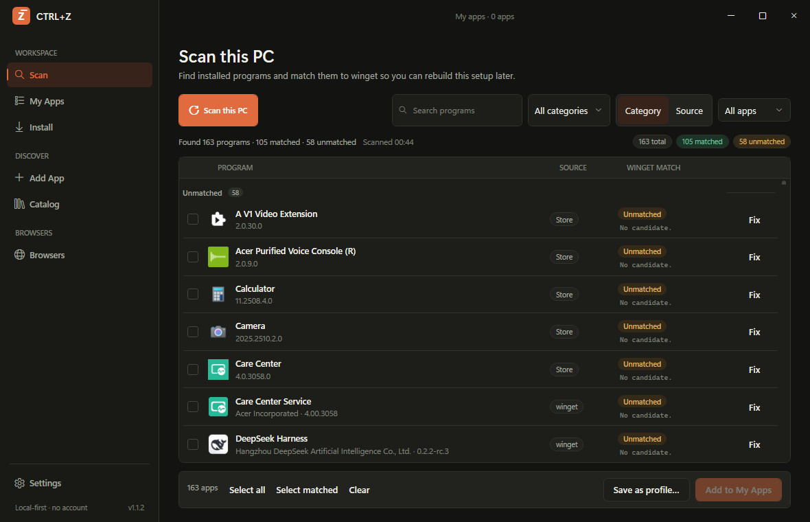
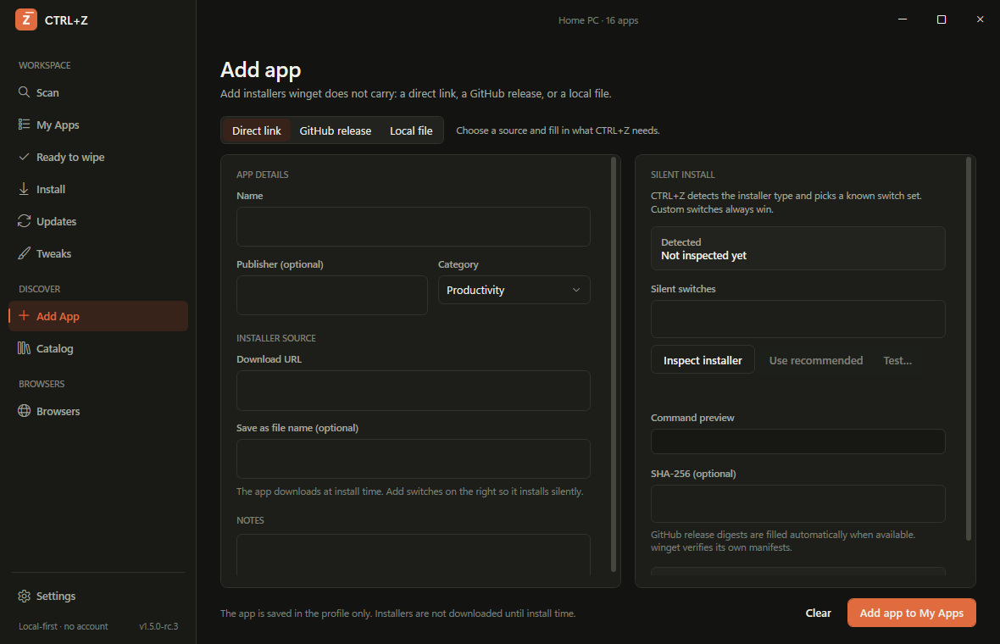
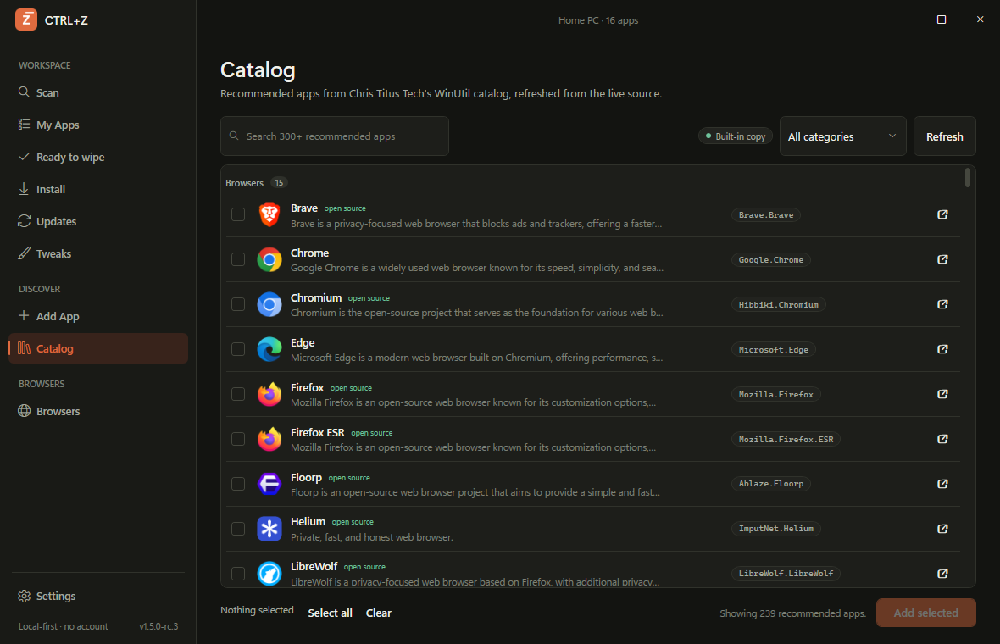
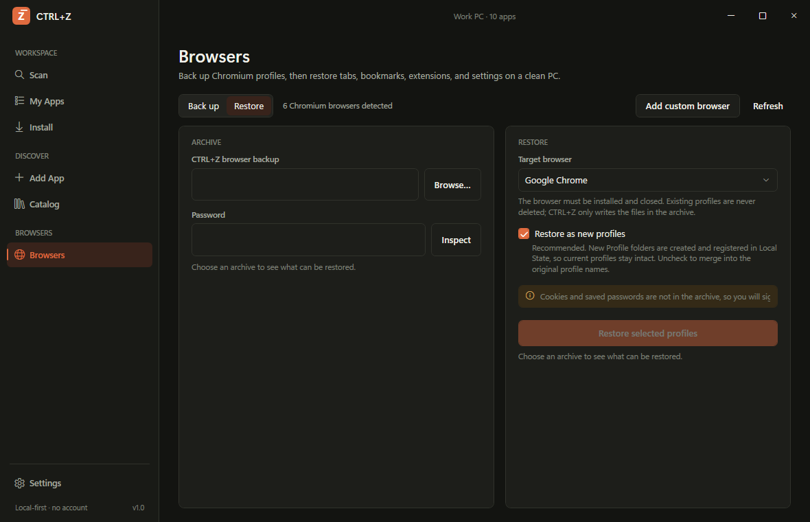

# CTRL+Z

**Undo a clean Windows install.**

[github.com/IAM-GROOT1/ctrlz](https://github.com/IAM-GROOT1/ctrlz)

CTRL+Z is a local-first Windows desktop app that rebuilds your app list and restores your
Chromium and Firefox browser profiles after a fresh install. It scans what is installed now,
saves a portable JSON profile, and reinstalls it silently later — including apps winget does
not carry. It also makes full browser-profile backups for browsers without sync, with a
focus on Helium, Zen, and multiple profiles.


| Scan | Add an app | Catalog |
| --- | --- | --- |
|  |  |  |

## Why this stack

I chose **.NET 8 + WPF** with a custom Fluent-inspired theme rather than Tauri/Electron:

- **No WebView2, Node, Rust, or JS runtime requirement.** A self-contained single-file
  `.exe` runs on a clean Windows 10/11 install.
- **Native Windows integration** for UAC relaunch, registry, shell icons, App Installer,
  process control, and Volume Shadow Copy.
- **A real GUI** that can be a proper Windows citizen — custom chrome, rounded
  corners, system light/dark themes, keyboard navigation, and native file dialogs.
- **Testable core.** `CtrlZ.Core` is a plain .NET class library; the installer, scan,
  winget matching, profile, and browser archive logic have no WPF dependency.

The UI deliberately uses a restrained ember accent, a small type scale, 8px surfaces, and
Segoe Fluent Icons — not a dashboard template. There are no gradients, glass panels, or
emoji icons.

## Features

### Rebuild apps

- Scan three sources: **winget**, **Windows registry Uninstall keys**, and **Microsoft Store
  (Appx)** apps.
- Match installed names to winget package ids with a conservative, tested matcher.
  Unmatched entries are grouped for manual fixing with a winget search dialog.
- Searchable, filterable lists; filter by **All apps / Matched / Unmatched**, filter by category,
  group by category or source, and multi-select. **Select all** selects every app visible under the
  active filter; **Select matched** is the matched-only shortcut.
- Save **multiple portable profiles** (`Work PC`, `Gaming PC`, …) as human-readable JSON;
  import/export them anywhere.
- Add apps winget does not carry:
  - **Direct download URL** with silent switches and optional SHA-256.
  - **GitHub release** with latest-release asset selection (`.exe`, `.msi`, `.zip`,
    portable). The latest release is resolved again at install time.
  - **Local installer** on a folder or USB drive, with silent switches.
- Built-in installer detection for **Inno Setup, NSIS, MSI, InstallShield, Squirrel, WiX
  Burn, MSIX**, plus a detected-type / command-preview inspector and a real test-install
  action for switches.
- A browsable **Chris Titus Tech WinUtil catalog** refreshed from the public repo, with an
  embedded snapshot + cached fallback for offline use.
- Silent, ordered installation with **per-app status, progress, live logs, retry, pause,
  resume after reboot, failed-app isolation, and UAC relaunch**.
- winget bootstrap: if winget is missing, CTRL+Z downloads Microsoft App Installer; if it
  is old, it attempts an App Installer upgrade.
- Download verification: winget verifies its own manifests; direct/GitHub/local downloads
  verify a supplied SHA-256, and GitHub release asset digests are used automatically when
  present.

### Chromium and Firefox browser backup

- Auto-detects **Chromium** browsers: Chrome, Edge, Brave, Vivaldi, Opera/Opera GX, **Helium**,
  Chromium, Thorium, Yandex, Comet, Arc, and Whale.
- Auto-detects **Firefox-family** browsers: Firefox/ESR, **Zen**, LibreWolf, Waterfox, Floorp,
  **Mullvad Browser**, and **Tor Browser**. Custom profile roots are supported for any fork.
- Reads real profile display names: Chromium from `Local State`, Firefox from `profiles.ini`
  (with a folder-name fallback for single-profile bundles).
- Select browsers and individual profiles.
- **Chromium backups include:** open tabs and sessions, history, bookmarks, extensions and
  extension data, preferences/flags (`Local State` + `Preferences`), search engines (sanitized
  `Web Data`), and site permissions.
- **Firefox backups include:** `prefs.js`/`user.js`, `places.sqlite` (bookmarks and history),
  `sessionstore.jsonlz4` and session backups, `extensions/` + extension metadata and storage,
  search engines (`search.json.mozlz4`), `permissions.sqlite`, bookmark backups, and `chrome/`
  customizations.
- **Never backs up saved passwords or cookies.** Chromium `Login Data`, `Cookies`, `Network`
  cookie stores, and related files are excluded; Firefox `logins.json`, `key4.db`, `cookies.sqlite`,
  `formhistory.sqlite`, and related credential stores are excluded.
- Excludes caches, shader caches, crash dumps, service-worker caches, thumbnails, and temp files.
- Shows the estimated size before starting.
- Detects a running browser (Chromium or Firefox process) and offers to close it gracefully or
  force-close it. Locked files fall back to **Volume Shadow Copy** when the app is elevated and
  VSS is available.
- One compressed ZIP per browser with a manifest (engine/family, browser, version, profiles,
  date, file list, contents, exclusions). Optional **AES-256 password encryption**.
- Restore flow: inspect archive → choose profiles → choose a target browser of the **same engine**
  → **restore as new profiles (recommended)** or merge into existing profiles after a warning.
  New Firefox profiles are registered in `profiles.ini`; new Chromium profiles in `Local State`.
  Existing cookies/passwords are left untouched; a small safety copy of key current files is made
  before writing.
- Per-browser configuration lives in
  [`ChromiumBrowserCatalog`](src/CtrlZ.Core/Services/ChromiumBrowserCatalog.cs) and
  [`FirefoxBrowserCatalog`](src/CtrlZ.Core/Services/FirefoxBrowserCatalog.cs).



### Everything else

- Clean empty states, inline errors, graceful per-item failure handling.
- All logs written to `%LOCALAPPDATA%\CTRL+Z\logs` and openable from Settings.
- Light/dark theme follows Windows by default.
- No account, telemetry, or cloud service.

## Install from the built artifacts

Download the latest build from [Releases](https://github.com/IAM-GROOT1/ctrlz/releases/latest). The release artifacts are (also copied to `dist/`):

- `CTRL+Z-Portable-1.1.3.exe` — a single self-contained executable. Put it anywhere and
  run it. No .NET install required.
- `CTRL+Z-Setup-1.1.3.exe` — per-user Inno Setup installer (Start Menu shortcut, optional
  desktop shortcut, uninstaller). It does not require admin to install.

The binaries are **not code-signed**, so SmartScreen may show an unknown-publisher prompt.
Build from source or sign the executable if you distribute it broadly.

### Portable data

By default the portable exe still keeps profiles, logs, and settings under
`%LOCALAPPDATA%\CTRL+Z`. For a fully portable data folder next to the exe, create an empty
file named `portable.flag` beside `CTRL+Z.exe` before launching. Data then lives in
`.\Data\`. You can also set `CTRLZ_DATA_DIR` to an explicit folder.

Profiles are portable regardless: export them from **My Apps → Export** and keep the JSON
with the installer or on a USB drive.

## Build and run

### Requirements

- Windows 10 1809+ or Windows 11, x64.
- [.NET 8 SDK](https://dotnet.microsoft.com/download/dotnet/8.0).
- Optional, only for the installer: [Inno Setup 6.3+](https://jrsoftware.org/isdl.php)
  (`ISCC.exe` on `PATH`, or under `.tools/InnoSetup6/ISCC.exe`).

The app itself runs on a clean Windows install with no prerequisites thanks to the
self-contained publish.

### Run from source

```powershell
git clone https://github.com/IAM-GROOT1/ctrlz.git
cd ctrlz
dotnet restore
dotnet run --project src/CtrlZ.App
```

### Tests

```powershell
dotnet test
```

The test suite covers: profile JSON round-tripping/import, winget name matching and table
parsing, silent-switch detection, Chromium and Firefox profile parsing, browser data exclusion
planning, Local State/Web Data sanitization, Firefox credentials exclusions, archive
creation/encryption, Firefox and Chromium restore into new profiles, install-state
resume/retry, and file/portable installer execution.

### Build the portable single exe

```powershell
.\build\publish.ps1 -Version 1.1.3
```

Outputs:

- `artifacts/publish/portable/CTRL+Z.exe`
- `artifacts/CTRL+Z-Portable-1.1.3.exe`
- README + LICENSE next to the portable build

The script uses `dotnet` from `PATH`, or a local `.tools/dotnet/dotnet.exe` if present.

### Build the installer

```powershell
.\build\build-installer.ps1 -Version 1.1.3
```

Output: `artifacts/installer/CTRL+Z-Setup-1.1.3.exe`.

If you use Winget, verify that it installs Inno Setup 6.3+ (the 6.x line is free for commercial use). The vendor still publishes 6.7.4 alongside newer releases.

## Using CTRL+Z on a fresh Windows install

1. Copy the portable exe or run the setup **and your exported profile JSON**.
2. Launch CTRL+Z. Open **My Apps → Import** and choose your profile (or use the profile
   already on the machine if you copied the data folder).
3. Review enabled apps and install order. Use **Add App** for custom sources, or **Catalog**
   for recommended apps.
4. Open **Install** and click **Install everything**. Accept the UAC prompt to restart CTRL+Z
   elevated; the app automatically resumes the saved queue after the relaunch.
5. If an installer needs a restart, CTRL+Z records it. Restart Windows and reopen CTRL+Z;
   the install queue resumes at the next unfinished app.
6. Open **Browsers → Restore**, inspect your archive, choose profiles and the target browser,
   and restore as new profiles (recommended) or merge into existing ones.

## Profile JSON

Profiles are intentionally simple and diffable:

```json
{
  "schemaVersion": 1,
  "id": "…",
  "name": "Work PC",
  "apps": [
    {
      "name": "7-Zip",
      "source": "winget",
      "packageId": "7zip.7zip",
      "category": "utilities",
      "enabled": true
    },
    {
      "name": "Notion",
      "source": "directUrl",
      "downloadUrl": "https://…",
      "silentArgs": "--silent",
      "expectedSha256": "…"
    },
    {
      "name": "Obsidian",
      "source": "github",
      "gitHubRepo": "obsidianmd/obsidian-releases",
      "gitHubAssetExtension": ".exe",
      "gitHubAssetKind": "installer"
    }
  ]
}
```

Paths for local installers are absolute by design; reconnect the same USB drive or edit the
path in **My Apps → Edit**.

## Architecture

```text
src/CtrlZ.Core                 UI-independent logic (net8.0-windows)
  Models/                      Profiles, app entries, install state, browser archives
  Services/                    Scanner, winget CLI/parser/matcher, GitHub, catalog,
                               browser detection/process/archive services
  Install/                     Source installers + resumable InstallEngine
  Infrastructure/              Paths, atomic file writes, process runner, JSON
src/CtrlZ.App                  WPF shell, custom Fluent theme, views, view models
tests/CtrlZ.Core.Tests         xUnit tests
installer/CTRL+Z.iss           Inno Setup definition
build/                         Publish + installer scripts
docs/                          Architecture, browser notes, VM restore testing
```

Key design decisions:

- **Profile state lives in `AppState`**, and every page goes through it. A profile is just
  JSON; there is no database.
- **Install sources are strategies** (`ISourceInstaller`). `InstallEngine` never knows how a
  winget, GitHub, URL, or local app is installed — it owns ordering, status, persistence,
  retry, and logs.
- **The install profile is snapshotted into the state file**, so a reboot or app restart can
  resume even if the original profile file changes.
- **Browser data policy is a whitelist** (`BrowserDataRules` + `BrowserBackupPlanner`). It is
  easy to audit what is and is not included.
- **Browser engines are explicit** (`Chromium` / `Firefox`) and forks are configuration. A new
  Chromium or Firefox fork is one catalog entry; the planner/restore pipeline dispatches by family.
- **No PowerShell dependency**: the app calls winget and PowerShell's Appx cmdlets directly
  for OS integration, but never asks the user to run a script.

### Adding a settings-backup module later

The current release deliberately does **not** back up general AppData/config folders. The code is separated
so this can be added without touching the installer or browser modules:

1. Add a `SettingsBackupPlanner` that produces a list of file entries and exclusions, like
   `BrowserBackupPlanner`.
2. Add a service that writes a manifest + archive. Reuse the ZIP/manifest conventions in
   `BrowserBackupService`/`BrowserArchiveReader`.
3. Add a page/view model and register it in `MainViewModel`; the existing `AppServices`
   composition root is the only wiring point.
4. Keep the same safety rules: never modify the source, skip credentials, and restore only
   into a user-chosen target.

## Browser backup limitations

These are known and intentional. Test a restore on a spare VM or a different Windows user
before relying on it for a critical profile.

- **Saved passwords and cookies are not backed up.** Sites will ask you to sign in again.
  This is by design: those stores are DPAPI-bound and do not restore cleanly under another
  Windows account.
- **Tab restore depends on browser session behavior.** Chromium uses `Sessions`,
  `Current/Last Session`, and `Current/Last Tabs`; Firefox uses `sessionstore.jsonlz4` and
  `sessionstore-backups`. Browsers may only reopen tabs when session restore is enabled, and
  behavior varies by version/fork.
- **Some extensions require re-enabling or signing in.** Extension code and state are copied,
  but Chromium and Firefox verify extension integrity and may disable sideloaded, unpacked, or
  unsigned extensions. Store extensions normally return; enterprise policies can override this.
- **Credential-bound data is sanitized.** Chromium `Local State` has the DPAPI-bound `os_crypt`
  key removed; Firefox archives never include `key4.db`, `logins.json`, or `cookies.sqlite`.
  Existing target encryption material is preserved during a merge. Restoring encrypted
  browser data from another Windows account is not supported.
- **Cross-fork restores are same-engine only.** Chrome↔Helium and Firefox↔Zen generally work
  within the same engine, but version-specific preferences may not. Chromium↔Firefox restores
  are rejected.
- **Single-profile layouts cannot add profiles.** Opera, Tor Browser, and some Mullvad layouts
  expose one flat profile. CTRL+Z restores it in place and warns that a second profile cannot be
  created.
- **Firefox profiles must be inside the profile root.** Profiles.ini entries pointing outside
  `%APPDATA%\Mozilla\Firefox` (or the fork's root) are skipped rather than copied blindly.
- **VSS fallback requires administrator rights** and may be unavailable on some drives or
  systems. Close the browser when prompted; that is the normal, reliable path.
- **Encrypted archives cannot be opened by Windows Explorer.** Use CTRL+Z to restore them.
  The password is never stored.
- **General app settings are not backed up** yet (see extension notes above).

## Testing browser restore on a fresh VM

See [`docs/TESTING-RESTORE.md`](docs/TESTING-RESTORE.md) for a repeatable VM procedure and
a checklist of what to verify (bookmarks, open tabs, extension state, search engines, site
permissions, and the absence of cookies/passwords).

## Troubleshooting

- **winget missing/outdated on a fresh PC** — CTRL+Z offers to install/update Microsoft App
  Installer. If the automatic bootstrap fails, install it manually from
  <https://aka.ms/getwinget> and retry.
- **A winget app opens a GUI instead of installing silently** — some packages ignore
  `--silent`. Test the installer switches from **Add App**, or use the vendor's direct
  installer with the correct switches in the profile.
- **Browser backup says a file is locked** — close the browser gracefully; if needed use
  **Force close**, or run CTRL+Z as administrator so the VSS fallback can be used.
- **GitHub release lookup fails** — anonymous GitHub API limits are 60 requests/hour. Set a
  `GITHUB_TOKEN` environment variable before launching CTRL+Z for a higher limit.
- **Logs** — **Settings → Open logs**, or open
  `%LOCALAPPDATA%\CTRL+Z\logs\ctrlz-YYYY-MM-DD.log`.

## Roadmap

- General AppData/config settings backup/restore module (structured for later; see above).
- Portable app shortcut creation and update tracking.
- Optional code signing / auto-update.
- Per-app download resumption and mirror selection.

## License

CTRL+Z is licensed under the GNU Affero General Public License v3.0 (see [`LICENSE`](LICENSE)). Versions up to and including v1.1.3 were released under the MIT License and remain available under those terms.

## Brand assets

The standalone CTRL+Z logo — the exact ember rounded square with a white Z and a right-offset dash used by the app — is in
[`branding/`](branding/). The app icon, window icon, header mark, Settings mark, and installer icon use this source. High-resolution PNGs, a transparent mark, and a multi-size Windows ICO are included.
